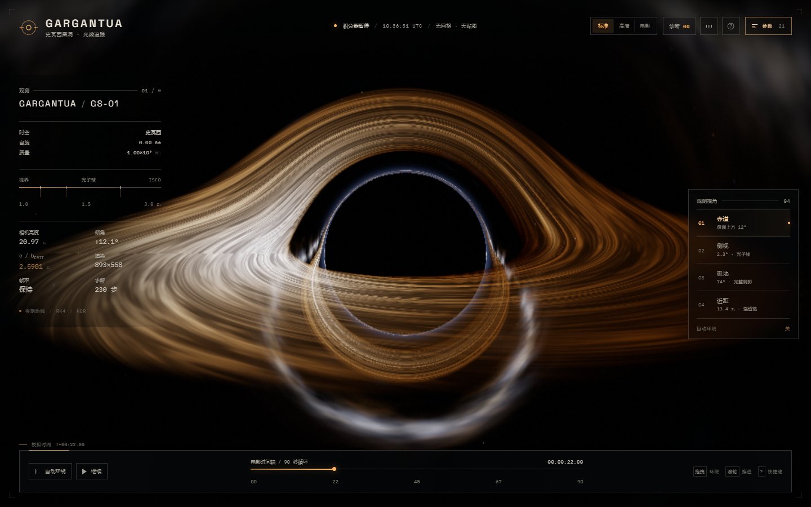

# GARGANTUA — 史瓦西黑洞光线追踪器 · 中文版

全屏交互式黑洞观测仪器。原生 HTML / CSS / JavaScript + ES Modules + 本地 Three.js，**无需构建**，无 CDN、无外部图片、无视频。

画面主体完全由片元着色器逐像素积分史瓦西零测地线生成：没有黑色球体网格、平面圆环、贴图、截图或预渲染画面。



---

## 快速启动

```powershell
cd D:\Users\admin\Desktop\GARGANTUA-CN
python -m http.server 4173
```

打开 **http://127.0.0.1:4173/**。

必须通过本地静态服务器访问；浏览器不允许 `file://` 加载 ES Modules。推荐最新版 Chrome / Edge / Firefox / Safari，并开启硬件加速。

---

## 功能

- **真实零测地线积分**：逐像素自适应 RK4，Cartesian 形式 `d²r/dλ² = -1.5 h² r / r⁵`，守恒角动量与首积分投影。
- **有限距离静态观测者修正**：每个初始方向按 `v₀ = f·d − (f−1)(d·r̂)r̂` 修正。
- **事件视界、光子球、临界曲线**：rₛ = 1，光子球 1.5 rₛ，ISCO 3 rₛ，b_c = 2.5981 rₛ。
- **多次吸积盘穿越**：三次 Hermite 求根，前向合成直接像、二次像与高阶像。
- **相对论辐射**：多普勒增亮、引力红移、黑体温度、bolometric g⁴ 转移、Shakura–Sunyaev 温度分布。
- **程序化星空与银河**：解析银河带、尘埃带、星云、哈希星场；全部经过引力透镜。
- **HDR 后处理**：RGBA16F、多尺度泛光、ACES、暗角、颗粒、轻微色散与抖动。
- **四个中文视角预设**：赤道 / 侧视 / 极地 / 近距。
- **21 项实时参数**，分光学、时空、吸积盘、星空四组。
- **0–9 诊断视图**：测地线场、临界曲线、多重像、多普勒、红移、HDR、泛光、步数成本、纯透镜星空。
- **电影环绕 / 暂停 / 全屏 / 界面隐藏 / 截图**。
- **移动端与 Retina** 自适应；画质分标准 / 高清 / 电影三档。
- **状态持久化、URL 深链接、截图自动化 API**。
- **WebGL 上下文丢失自动恢复**：保留相机、参数、模拟时间。

---

## 操作

| 按键 | 功能 |
|---|---|
| `0`–`9` | 诊断视图，`0` 返回最终合成 |
| `Q` / `W` / `E` / `R` | 赤道 / 侧视 / 极地 / 近距 |
| `V` | 循环切换视角 |
| `C` | 开关电影环绕 |
| `P` / `Space` | 暂停 / 继续 |
| `G` | 参数面板 |
| `H` | 隐藏 / 显示界面 |
| `M` | 环境音乐 |
| `F` | 全屏 |
| `S` | 保存当前帧 PNG |
| `?` | 快捷键与科学说明 |
| `Esc` | 关闭浮层 |

鼠标拖拽环绕，滚轮缩放；移动端单指环绕、双指缩放。

---

## 21 项参数

| 参数 | 范围 | 默认 |
|---|---:|---:|
| 曝光 | 0.20–3.00 | 0.92 |
| 泛光强度 | 0–2 | 0.34 |
| 泛光阈值 | 0–3 | 1.45 |
| 胶片颗粒 | 0–1 | 0.16 |
| 暗角 | 0–1.5 | 0.60 |
| 色散 | 0–1.5 | 0.18 |
| 多普勒增亮 | 0–2× | 1.00 |
| 引力红移 | 0–2× | 1.00 |
| 光子日冕 | 0–1.5 | 0.12 |
| 盘面亮度 | 0–4 | 0.76 |
| 峰值温度 | 2,800–16,000 K | 4,800 K |
| 内半径 | 2.0–6.0 rₛ | 3.00 rₛ |
| 外半径 | 6–24 rₛ | 11.0 rₛ |
| 湍流 | 0–1.5 | 0.78 |
| 湍流尺度 | 0.3–8 | 2.90 |
| 轨道速度 | 0–4× | 0.85× |
| 盘面厚度 | 0.01–0.60 rₛ | 0.20 rₛ |
| 光学深度 | 0.05–1.00 | 0.62 |
| 星空亮度 | 0–3 | 0.72 |
| 恒星密度 | 0–2 | 1.00 |
| 银河带 | 0–2 | 1.00 |

内半径 3 rₛ 对应史瓦西 ISCO；更小值为非开普勒艺术控制。盘面厚度是柔和光学厚度与掠射路径长度，不是几何网格。

---

## 画质

| 档位 | 最大步数 | 泛光级数 | DPR 上限 | 像素预算 |
|---|---:|---:|---:|---:|
| 标准 | 230 | 4 | 1.15 | 1.45 MP |
| 高清 | 310 | 5 | 1.75 | 3.40 MP |
| 电影 | 520 | 6 | 2.0 | 7.20 MP |

窄屏默认标准画质；桌面默认高清。URL `scale=0.2–2` 仅供自动化测试。

---

## URL 深链接 / 截图自动化

```text
http://127.0.0.1:4173/?shot=1&ui=1&preset=equatorial&quality=high&time=22&cinematic=0&paused=1
```

常用参数：

| 参数 | 说明 |
|---|---|
| `quality` | `standard` / `high` / `cinematic` |
| `preset` | `equatorial` / `edge` / `polar` / `close` 或 0–3 |
| `debug` | 0–9 |
| `time` | 模拟时间（秒） |
| `cinematic` / `paused` | `0` / `1` |
| `shot` | 截图模式：暂停、确定性起始、默认隐藏 UI |
| `ui` | `0` / `1` 覆盖界面显示 |
| `capture` | `1` 时自动生成 PNG data URL |
| `fresh` | `1` 忽略 localStorage |
| `scale` | 渲染倍率（测试用） |
| `camera` / `fov` | 手动相机位置 / 视场角 |
| `p` | 分享链接中的紧凑参数包 |

`capture=1` 时等待 `window.__GARGANTUA_CAPTURE_READY__ === true`，读取 `window.__GARGANTUA_CAPTURE__`。

### JavaScript API

```js
GARGANTUA.getState();
GARGANTUA.set({ preset: 'polar', quality: 'cinematic', debug: 2, paused: true });
GARGANTUA.setParam('diskSpeed', 0);
const png = await GARGANTUA.capture();  // 纯 WebGL 画布，不含 HUD
GARGANTUA.getShareLink();
GARGANTUA.getDiagnostics();
```

事件：`gargantua:ready`、`gargantua:capture`。

---

## 验收

- **22 / 22 通过，0 失败**
- **0 控制台错误，0 页面异常**
- 覆盖：启动、电影镜头、截图 API、快捷键、四个视角、0–9 诊断、21 参数、三档画质、OrbitControls、跨刷新持久化、盘面动态、分享链接、WebGL 上下文恢复、移动端布局、确定性 URL 截图。
- 报告：[tests/out/acceptance/report.md](tests/out/acceptance/report.md)
- 移动端截图：[mobile-default.png](tests/out/acceptance/mobile-default.png)

---

## 目录

```text
GARGANTUA-CN/
├─ index.html
├─ css/style.css
├─ js/            config · shaders · engine · ui · audio · main
├─ vendor/three/  Three.js r170 + OrbitControls（本地）
├─ assets/        字体 · 环境音乐
├─ tests/         CDP 验收脚本 · 中文截图与报告
├─ README.md
└─ LICENSE
```

物理、URL 参数、快捷键与验收说明均在本文件；更详细英文实现说明见同系列英文版 README。

---

## 许可与素材

- Three.js r170 — MIT，见 `vendor/three/LICENSE`。
- Space Grotesk、IBM Plex Mono — SIL OFL 1.1，见 `assets/fonts/`。
- 环境音乐《Ambient Horizon》— 本项目原创程序化音频，见 `assets/audio/README.md`。

> “阴影并非空无。那是光去往的地方。”
