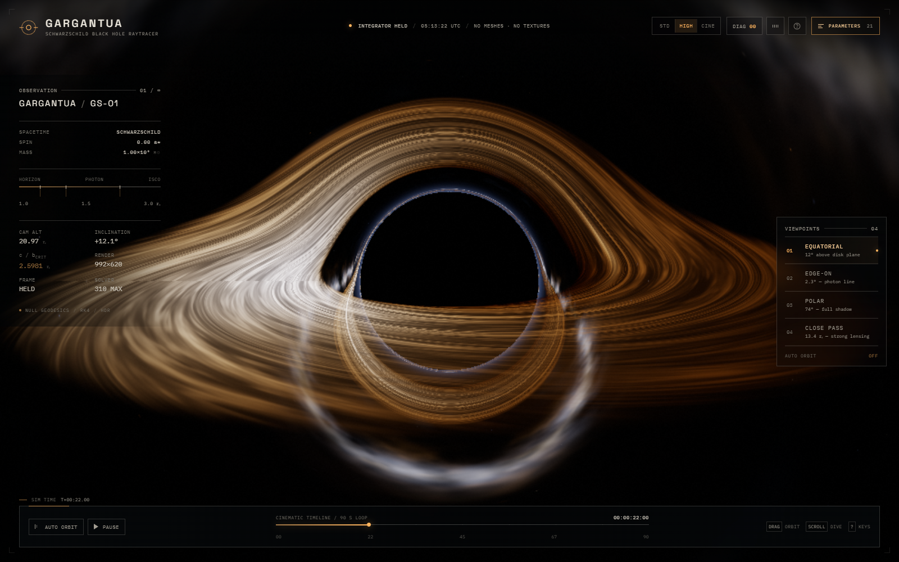
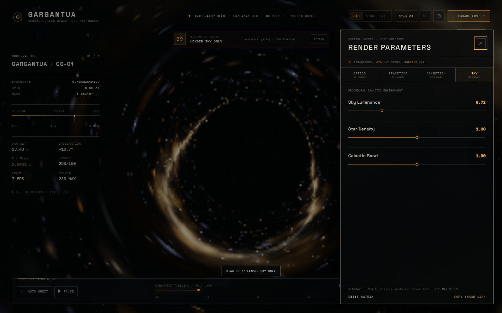

# GARGANTUA — Schwarzschild Black Hole Raytracer

A full-screen, interactive black-hole instrument built with native HTML/CSS/JavaScript, ES Modules and a local Three.js build. There is **no build step** and no runtime CDN dependency.

Every pixel of the black hole, its shadow, photon ring, lensed sky and turbulent accretion disk is produced by a **per-pixel null-geodesic integration in a fragment shader**. No sphere mesh, billboard, flat ring, texture, video, screenshot or baked cubemap is used for the subject.



---

## 1. Run it

From this folder:

```powershell
# Windows PowerShell
python -m http.server 4173
```

or:

```bash
# macOS / Linux
python3 -m http.server 4173
```

Open <http://127.0.0.1:4173/>.

> **Use a static server.** The app uses native ES modules and an import map; opening `index.html` via `file://` is blocked by browsers.
> Recommended: current Chrome/Edge, Firefox or Safari with WebGL2 and hardware acceleration enabled. A dedicated GPU is recommended for the High and Cinematic profiles.

No installation, package manager or build command is required. Three.js r170 and OrbitControls are vendored under `vendor/three/`. Fonts and the ambient track are local.

---

## 2. What the shader actually solves

Units are geometrized with the Schwarzschild radius **rₛ = 1**, therefore M = ½.

| Quantity | Value |
|---|---|
| Event horizon | 1.000 rₛ |
| Photon sphere | 1.500 rₛ |
| ISCO | 3.000 rₛ |
| Critical impact parameter | b<sub>c</sub> = 3√3/2 = **2.598076 rₛ** |
| Black-hole spin | 0.00 (Schwarzschild) |
| Display peak disk temperature | 2,800–16,000 K (rescaled visible range; default 4,800 K) |

The camera ray is integrated backwards with **classical adaptive RK4**:

```glsl
// conserved specific angular momentum, computed once
h2 = dot(cross(pos, vel), cross(pos, vel));

// Schwarzschild null geodesic, Cartesian form
d²r/dλ² = -1.5 * h2 * r / r⁵;
```

Key implementation details:

- The **finite-radius static observer correction** is applied to every initial ray direction; omitting it changes the shadow size by several percent at the camera distances used here.
- After every step the state is projected back onto the null first integral by correcting only the radial velocity component. This protects near-critical rays from numerical capture/escape flicker.
- The integration stops on horizon capture, escape (`r > 56 rₛ` and outgoing), or a 520-step budget.
- Equatorial disk crossings are solved with a **cubic Hermite root**, not a single linear sign check. Each crossing is composited front-to-back with absorption, allowing direct, secondary and higher-order images.
- The local circular-orbit speed is β = √(M / (r − 2M)); the observed temperature is T<sub>obs</sub> = gT<sub>em</sub> with the full factor

```glsl
g = sqrt(1 - r_s/r) / (gamma * (1 - beta·n_photon));
```

- Brightness uses bolometric **g⁴** transfer. Approaching and receding limbs therefore differ in both colour and brightness, including the reversed Doppler asymmetry of higher-order images.
- The sky is sampled from the **final asymptotic ray direction**, so the Milky Way, dust lanes and resolved stars are genuinely gravitationally lensed.
- HDR radiance is written into an **RGBA16F** target, then processed through thresholded multi-scale bloom, ACES filmic tone mapping, slight lateral chromatic dispersion, vignette, animated film grain and dither.

The **photon corona** is optically thin emission accumulated only after an outgoing ray passes near r = 1.5 rₛ; it is an integral of the real ray path, not a screen-space circle. The critical curve itself comes from the geodesics and multiple disk crossings; there is no drawn ring.

The display temperature is deliberately compressed into the visible band rather than the real 10⁶–10⁷ K of an astrophysical disk. This is an instrument for seeing the geometry, not an X-ray observatory. Everything geometric remains Schwarzschild.

---

## 3. Interface



- **HUD** — live camera altitude, inclination, critical-impact constant, render resolution, renderer FPS/step profile, solver state, UTC observation time.
- **Four authored viewpoints** — Equatorial, Edge-on, Polar, Close Pass. Smooth camera tweens; OrbitControls resumes after the tween.
- **Cinematic orbit** — a seamless 90-second camera loop with gentle radius, inclination and FOV modulation. Grab the canvas or scroll to take manual control instantly.
- **21 live parameters** — grouped into Optics, Spacetime, Accretion and Sky. Every slider writes a live shader/display uniform and persists.
- **10 diagnostic views** — `0`–`9`. See below.
- **HUD hiding** — `H` yields a clean plate; `S` downloads the current pure WebGL frame.
- **Optional ambient music** — generated locally (`assets/audio/ambient-horizon.ogg`), 75-second seamless loop, starts **only** after an explicit click or `M`.
- **URL/deep-link state** and **localStorage persistence**.
- **Quality profiles** — Standard / High / Cinematic.
- **Responsive mobile layout**, touch orbit, safe-area-aware deck, bottom-sheet parameter matrix.
- **Retina-aware renderer** — internal resolution uses devicePixelRatio with per-profile caps and a total pixel budget.
- **WebGL recovery** — context loss is caught, the HUD shows a restore overlay, and automatic restore attempts are made using a durable `WEBGL_lose_context` reference. A manual restore and safe-mode fallback are available.

### Keyboard shortcuts

| Key | Action |
|---|---|
| `0`–`9` | Diagnostic view (`0` = final composite) |
| `Q` / `W` / `E` / `R` | Equatorial / Edge-on / Polar / Close Pass |
| `V` | Next viewpoint |
| `C` | Toggle cinematic orbit |
| `P` or `Space` | Pause / resume simulation |
| `G` | Parameter matrix |
| `H` | Hide / restore interface |
| `M` | Ambient music |
| `F` | Fullscreen |
| `S` | Save current frame as PNG |
| `?` | Shortcut ledger + scientific notes |
| `Esc` | Close help / parameter panel |

### Mouse / touch

- Drag — orbit.
- Scroll / pinch — change distance.
- Pan is intentionally disabled so the black hole remains the optical axis.

---

## 4. Quality profiles

| Profile | Max RK4 steps | Bloom levels | DPR cap | Pixel budget | Notes |
|---|---:|---:|---:|---:|---|
| Standard | 230 | 4 | 1.15 | 1.45 MP | Default on narrow/mobile devices |
| High | 310 | 5 | 1.75 | 3.40 MP | Default on desktop |
| Cinematic | 520 | 6 | 2.0 | 7.20 MP | Maximum fidelity |

The shader loop is capped at 520. Mobile devices additionally receive a reduced pixel budget. The URL-only `scale=` parameter (0.2–2.0) is provided for automated testing and low-power capture; it is not exposed in the UI.

---

## 5. The 21 parameters

| ID | Label | Range | Default |
|---|---:|---:|---:|
| `exposure` | Exposure | 0.20–3.00 | 0.92 |
| `bloomStrength` | Bloom Strength | 0–2 | 0.34 |
| `bloomThreshold` | Bloom Threshold | 0–3 | 1.45 |
| `grain` | Film Grain | 0–1 | 0.16 |
| `vignette` | Vignette | 0–1.5 | 0.60 |
| `chromatic` | Dispersion | 0–1.5 | 0.18 |
| `doppler` | Doppler Beaming | 0–2 | 1.00 |
| `redshift` | Gravitational Redshift | 0–2 | 1.00 |
| `photonGlow` | Photon Corona | 0–1.5 | 0.12 |
| `diskBrightness` | Disk Brightness | 0–4 | 0.76 |
| `diskTemp` | Peak Temperature | 2,800–16,000 K | 4,800 K |
| `diskInner` | Inner Radius | 2.0–6.0 rₛ | 3.00 rₛ |
| `diskOuter` | Outer Radius | 6–24 rₛ | 11.0 rₛ |
| `turbulence` | Turbulence | 0–1.5 | 0.78 |
| `noiseScale` | Turbulence Scale | 0.3–8 | 2.90 |
| `diskSpeed` | Orbital Speed | 0–4× | 0.85× |
| `diskThickness` | Disk Thickness | 0.01–0.60 rₛ | 0.20 rₛ |
| `diskOpacity` | Optical Depth | 0.05–1.00 | 0.62 |
| `skyBrightness` | Sky Luminance | 0–3 | 0.62 |
| `starDensity` | Star Density | 0–2 | 1.00 |
| `milkyway` | Galactic Band | 0–2 | 1.00 |

`diskInner = 3 rₛ` is the physical Schwarzschild ISCO. Values below 3 are intentionally non-Keplerian but remain valid as a visual control. `diskThickness` controls soft optical thickness and grazing path length, not mesh thickness.

---

## 6. Diagnostic views (`0`–`9`)

| Code | View | What it shows |
|---|---|---|
| `0` | Final composite | Fully processed HDR plate |
| `1` | Geodesic field | windings, capture/escape, disk image contribution |
| `2` | Critical curve | screen impact parameter vs. b<sub>c</sub> = 2.5981 rₛ |
| `3` | Multi-image | number of equatorial crossings per pixel |
| `4` | Doppler shift | accumulated approaching/receding g factor |
| `5` | Gravitational redshift | accumulated √(1 − rₛ/r) at sampled disk points |
| `6` | HDR buffer | log-luminance before tone mapping |
| `7` | Bloom isolation | thresholded multi-scale bloom only |
| `8` | Ray step cost | adaptive integration cost per pixel |
| `9` | Lensed sky only | accretion disk/corona disabled; Einstein arcs remain |

The diagnostic strip beneath the top bar identifies the current view. Press `0` or click `RETURN` to go back to the final plate.

---

## 7. Screenshot automation and deep links

All state can be driven from the URL, so no external build or configuration is needed for reproducible capture.

Example — clean 35 mm still, no UI, no animation:

```text
http://127.0.0.1:4173/?shot=1&ui=0&quality=high&preset=edge&time=31.5&cinematic=0&debug=0
```

Example — UI review plate:

```text
http://127.0.0.1:4173/?shot=1&ui=1&quality=standard&preset=equatorial&time=22&cinematic=0&paused=1
```

Supported query parameters:

| Parameter | Values | Meaning |
|---|---|---|
| `quality` | `standard`, `high`, `cinematic` | Renderer profile |
| `preset` | `0`–`3`, `equatorial`, `edge`, `polar`, `close` | Authored viewpoint |
| `debug` | `0`–`9` | Diagnostic view |
| `time` | seconds | Deterministic simulation/disk time |
| `cinematic` | `0`/`1` | Auto-orbit on/off |
| `paused` | `0`/`1` | Freeze integration |
| `shot` | `0`/`1` | Screenshot mode: pause, hide UI by default, deterministic start time |
| `ui` | `0`/`1` | Interface visibility (overrides shot default) |
| `capture` | `0`/`1` | After ready, expose an auto-generated PNG data URL |
| `fresh` | `0`/`1` | Ignore localStorage and start from URL defaults |
| `scale` | 0.2–2.0 | Automated test render-scale override |
| `camera` | `x,y,z` | Manual camera position |
| `fov` | 20–80 | Manual field of view |
| `p` | URL-safe base64 JSON | Compact parameter pack used by **Copy Share Link** |
| any param id | numeric | Direct override, e.g. `exposure=1.1&diskTemp=9000` |

When `capture=1`, wait for `window.__GARGANTUA_CAPTURE_READY__ === true`, then read `window.__GARGANTUA_CAPTURE__`. The canvas is exposed through the same pure render path as the visible plate.

### JavaScript API

```js
// Wait for window.__GARGANTUA_READY__ === true (or the gargantua:ready event).

GARGANTUA.getState();
// → { ready, quality, preset, debug, cinematic, paused, time, params, camera, ... }

GARGANTUA.set({
  quality: 'high',
  preset: 'polar',
  debug: 2,
  paused: true,
  time: 31.5,
  params: { exposure: 1.1, diskTemp: 7800 },
  uiVisible: true,
  cinematic: false,
});

GARGANTUA.setParam('diskSpeed', 0);
GARGANTUA.setCamera({ position: [0, 6, 18], fov: 38 });

const dataUrl = await GARGANTUA.capture({ download: false });
// "data:image/png;base64,..." — pure WebGL canvas, no HUD.

GARGANTUA.getShareLink();       // full state as a deep link
GARGANTUA.getDiagnostics();     // GPU, resolution, shader/context status, runtime errors
GARGANTUA.debug.loseContext();  // test the recovery path (diagnostic only)
```

Events:

- `gargantua:ready` — first composited frame is ready.
- `gargantua:capture` — emitted when `capture=1` produces `__GARGANTUA_CAPTURE__`.

State is persisted to `localStorage` under `gargantua:state:v1` (parameters, quality, preset, cinematic mode, debug view, and manual camera position). Add `fresh=1` to bypass persistence.

---

## 8. Project layout

```text
gargantua/
├─ index.html
├─ css/
│  └─ style.css
├─ js/
│  ├─ config.js        # 21 params, viewpoints, quality profiles, debug definitions
│  ├─ shaders.js       # geodesic fragment shader + HDR/bloom/composite GLSL
│  ├─ engine.js        # WebGL2 renderer, FBOs, post pipeline, recovery
│  ├─ ui.js            # HUD, parameter matrix, help, telemetry
│  ├─ audio.js         # optional local ambient playback
│  └─ main.js          # camera rig, state, shortcuts, URL/API, boot
├─ vendor/three/
│  ├─ three.module.js  # r170, local
│  ├─ OrbitControls.js
│  └─ LICENSE
├─ assets/
│  ├─ fonts/           # Space Grotesk + IBM Plex Mono, local WOFF2 + OFL licenses
│  └─ audio/           # ambient-horizon.ogg + original composition notes
├─ tests/
│  ├─ acceptance.mjs   # zero-dependency headless-browser acceptance suite
│  ├─ cdp.mjs          # CDP CLI helper (shot / wait / eval)
│  └─ out/acceptance/  # report.json, report.md, screenshots
├─ LICENSE
└─ README.md
```

---

## 9. Compatibility, limitations and notes

- **WebGL2 is required.** The primary surface uses 16-bit float render targets; if the GPU cannot render into RGBA16F the renderer falls back to RGBA8 for the bloom chain instead of failing to a black screen.
- Mobile Safari/Chrome can be warm and battery-heavy in Cinematic. Standard is the default on narrow screens.
- The disk is an infinitesimally thin equatorial emitting surface with a soft optical depth parameter; multiple crossings are real; there is no volumetric raymarch inside the disk. This keeps the integration fast and the multiple-image structure readable.
- The photon corona is a deliberately subtle optically thin addition near the photon sphere, traced along the actual outgoing path, to keep the critical structure legible on lower-DPR screens. It is not a screen-space ring.
- The Milky Way and stars are procedural, no external sky map is used. Star cells are hashed directly in direction space; there is no tiling texture.
- Disk display temperatures and surface radiance are artistically rescaled from astrophysical values; the geodesics, ISCO, photon sphere, critical impact parameter and Doppler/redshift factors are not.
- `scale=`/`?fresh=` are diagnostic/test controls. They intentionally do not appear in the in-world HUD.

---

## 10. Validation

Browser acceptance tests were run against a local static server (`python -m http.server 4173`) using headless Chromium with WebGL2 (SwiftShader in the test host). The suite checks bootstrap, cinematic motion, screenshot API, pause/UI shortcuts, all four viewpoints, all ten debug views, all 21 sliders, quality profiles, OrbitControls drag, URL overrides, persistence, share links, mobile layout, and WebGL context loss/restoration. Console and page-error counts are asserted to be zero.

See [`tests/out/acceptance/report.md`](tests/out/acceptance/report.md) for the latest recorded run.

To rerun (requires a Chrome/Chromium listening on CDP port 9334):

```powershell
# terminal 1
python -m http.server 4173

# terminal 2 — start headless Chrome once
& "C:\Program Files\Google\Chrome\Application\chrome.exe" `
  --headless=new --no-sandbox --disable-crash-reporter --disable-breakpad `
  --remote-debugging-port=9334 --remote-allow-origins=* `
  --user-data-dir="$PWD\tests\cdp-runtime" --use-angle=swiftshader `
  --enable-unsafe-swiftshader about:blank

# terminal 3
node tests/acceptance.mjs
```

The test suite writes `report.json`, `report.md` and full-resolution screenshots under `tests/out/acceptance/`.

---

## 11. Credits

- **Three.js r170** — MIT, bundled locally (`vendor/three/LICENSE`).
- **Space Grotesk** by Florian Karsten — SIL OFL 1.1.
- **IBM Plex Mono** by IBM — SIL OFL 1.1.
- **Ambient Horizon** — original procedural composition generated in-repo for GARGANTUA; see `assets/audio/README.md`.
- Geodesic formulation and disk physics follow standard Schwarzschild null-geodesic results; implementation details (finite observer correction, step projection, Hermite crossings, HDR presentation) are documented in the source and in the in-app scientific notes.

> *“The shadow is not empty. It is where the light goes.”*
